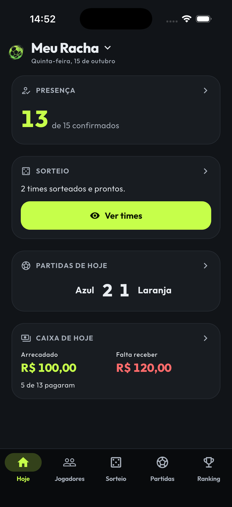
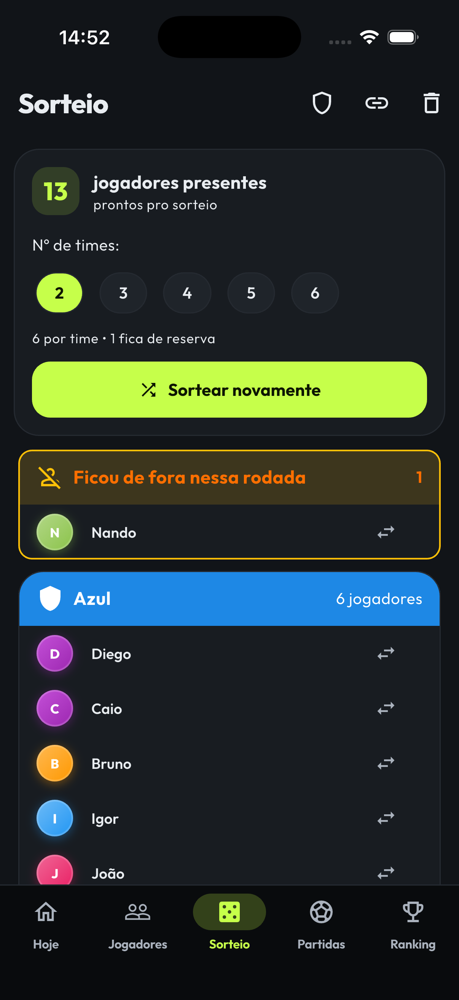
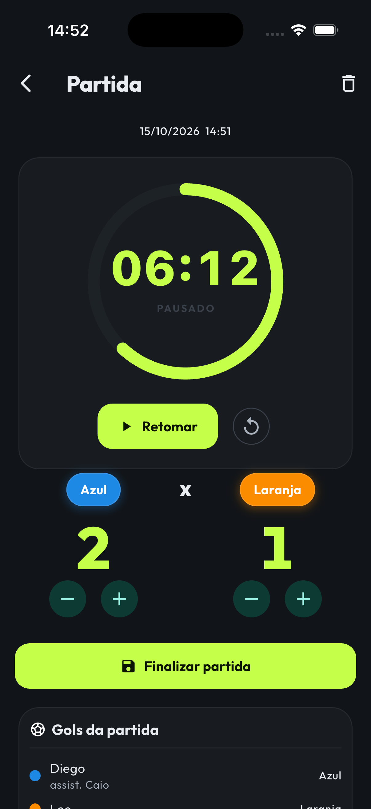
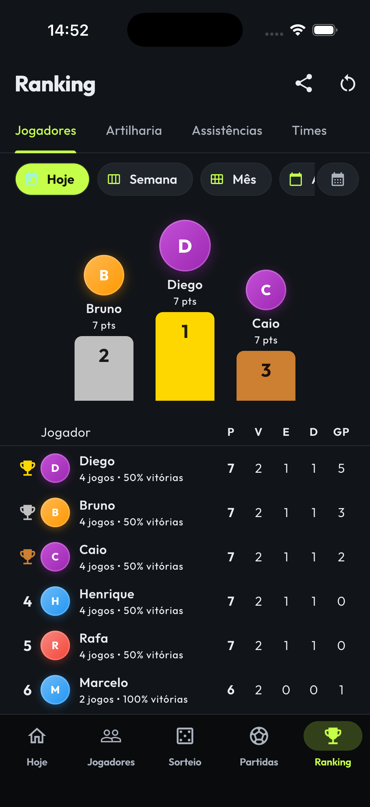
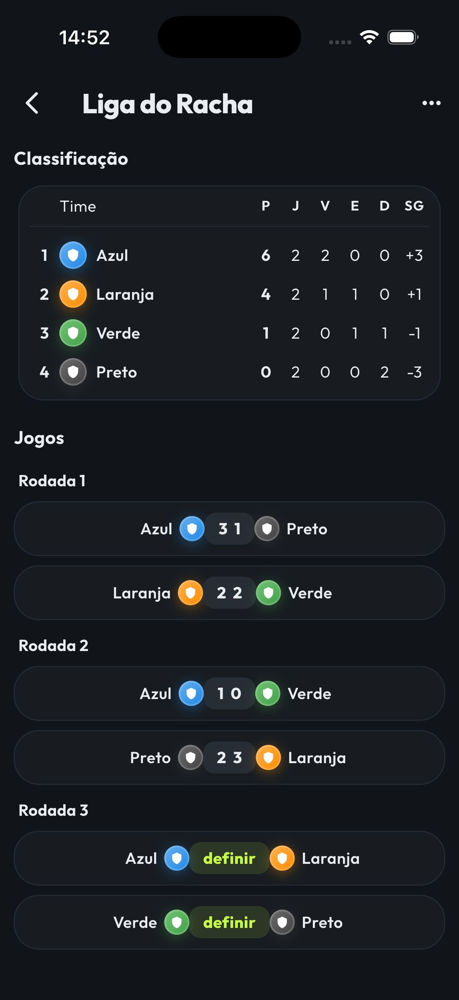
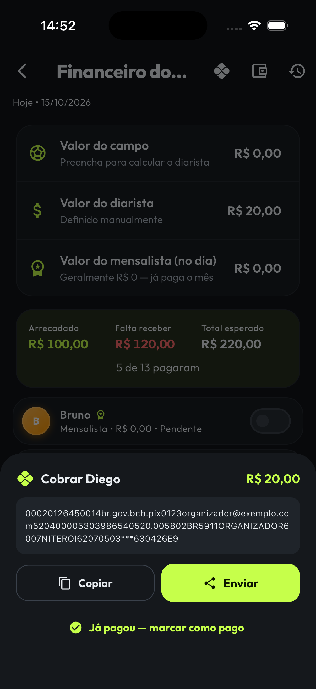
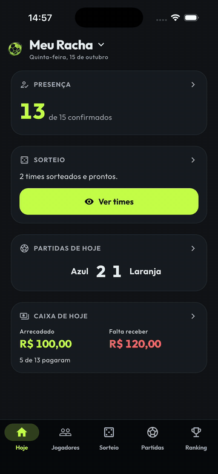
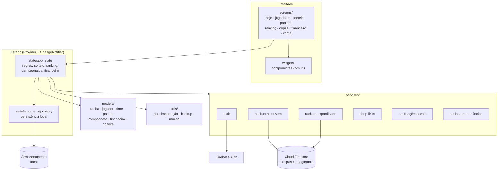

# ⚽ Rachinha

> **Organize a pelada do começo ao fim:** quem vai jogar, sorteio dos times, placar, ranking, campeonatos e quem já pagou, tudo num lugar só.

**O problema:** quem organiza o racha com os amigos faz tudo no caderno ou no grupo do WhatsApp: lista de presença, sorteio dos times na hora, placar, artilheiro e a cobrança de quem não pagou. O Rachinha resolve isso no celular, **funcionando offline na beira do campo**, e deixa compartilhar o resultado com o grupo em segundos.

---

## Screenshots

  
  
  
  

  
  

---

## Funcionalidades

**Organização do jogo**
- **Painel "Hoje"**: em uma tela, quem confirmou presença, os times sorteados, a partida em andamento e quanto falta receber
- **Jogadores**: cadastro com foto, presença do dia com um toque e marcação de mensalista
- **Importar lista do WhatsApp**: cole a lista ("1- Fulano", "2 - Ciclano"…) e o app cadastra os jogadores
- **Times** com nome, cor e imagem
- **Sorteio** de 2 a 6 times, com duplas que devem jogar **juntas** ou **separadas**, reservas e ajuste manual depois do sorteio

**Durante a partida**
- Placar com registro de **gols e assistências** por jogador
- **Cronômetro** com notificação quando o tempo acaba, mesmo com o app fechado, e encerramento por número de gols

**Depois do jogo**
- **Ranking** em quatro abas: Jogadores, Artilharia, Assistências e Times
- **Campeonatos** em formato de liga (todos contra todos) ou mata-mata com chaveamento
- **Cards para compartilhar** (times, resultados, ranking) como imagem no WhatsApp

**Dinheiro**
- **Financeiro**: diária, mensalidade, custo do campo e caixa de despesas
- **Cobrança por Pix "copia e cola"** com o valor de cada jogador, gerada no próprio app

**Conta e dados**
- **Vários rachas** (grupos/temporadas), cada um com histórico próprio
- **Conta** com Firebase Auth e **backup na nuvem**; também exporta e importa backup em arquivo
- **Racha compartilhado**: o organizador convida os jogadores por link e eles acompanham o racha em tempo real, só leitura

**Em configuração para o lançamento**
- Assinatura **Pro** (sem anúncios, backup automático, sem marca d'água): fluxo e telas prontos; a integração de cobrança com as lojas (RevenueCat) ainda não está ativa
- Anúncios no plano grátis: implementados, ainda com IDs de teste

---

## Destaques técnicos

**Sorteio com restrições de duplas.** O sorteio não é só embaralhar. O organizador pode travar duplas que **sempre jogam juntas** e duplas que **nunca podem cair no mesmo time**. O algoritmo agrupa os "juntos" em blocos (com uma estrutura *union-find*, que resolve encadeamentos como "A com B" e "B com C"), aloca primeiro os blocos com restrição de "separados", enquanto os times ainda estão vazios, e mantém **todos os times com o mesmo número de jogadores**. Quem sobra vai para a reserva, em vez de deixar um time maior que o outro. As regras são cumpridas "na medida do possível": quando não há solução perfeita, o app prioriza times iguais.

**Pix "copia e cola" gerado 100% offline.** O app monta o código Pix no padrão do Banco Central (BR Code/EMV), com a chave do organizador e o valor de cada jogador. O código funciona em qualquer app de banco, **sem gateway, sem taxa e sem servidor**: o dinheiro cai direto na conta de quem organiza.

**Local-first, com nuvem opcional.** Por padrão, tudo fica salvo no aparelho e o app funciona sem internet, o que é essencial na beira do campo. A nuvem entra só quando o usuário escolhe: backup da conta ou racha compartilhado.

**Racha compartilhado com segurança no Firestore.** O modelo é "um escreve, muitos leem": só o organizador altera times, placar e financeiro, e os jogadores acompanham em tempo real. As **regras de segurança do Firestore** garantem isso no servidor. Um jogador convidado consegue apenas **se adicionar** à lista de membros (ou sair dela), sem alterar mais nada. Tudo o que não está explicitamente liberado é negado.

**Convite por link que abre o app.** O link de convite usa **App Links (Android) e Universal Links (iOS)**. Ao tocar, o app abre direto na tela de entrar no racha, tanto se já estava aberto quanto se foi iniciado pelo link.

**Notificação do cronômetro que funciona com o app fechado.** O fim da partida é agendado como notificação local por horário absoluto, e o Android mostra uma contagem regressiva fixa na barra de notificações, como o cronômetro nativo do celular.

**Testes em três níveis.** Testes unitários das regras (sorteio, financeiro, caixa, Pix, campeonatos, estatísticas de partida, importação de jogadores), testes de widget das telas e **testes de integração** que rodam o app de verdade no aparelho e simulam os toques.

**Pronto para as lojas.** Exclusão de conta dentro do app e por página web, política de privacidade publicada e build de release assinado, conforme as exigências da Google Play e da App Store.

---

## Arquitetura

---

## Status

🚧 **Em desenvolvimento**, com publicação prevista na App Store e na Google Play.

> 🔒 **O código-fonte é privado.** Disponível para avaliação técnica mediante solicitação.

---

## Sobre mim

Sou **Daniel Coelho**, desenvolvedor mobile Flutter e estudante de Análise e Desenvolvimento de Sistemas.

